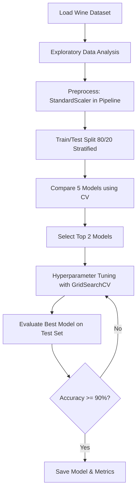

# Wine Classification: End-to-End Supervised Learning Pipeline


## Problem Statement
The goal of this project is to classify wine into three distinct cultivars (classes) based on 13 chemical features (e.g., Alcohol, Malic acid, Ash, etc.). We use the classic Wine Dataset from `scikit-learn`.

## Pipeline Flowchart


## Dataset
- **Source**: `scikit-learn` built-in datasets (originally from UCI Machine Learning Repository).
- **Features**: 13 numeric, predictive attributes.
- **Classes**: 3 distinct wine cultivars.

## Results & Model Comparison
Our pipeline compares K-Nearest Neighbors, Support Vector Machine, Logistic Regression, Decision Tree, and Random Forest. 
After identifying the top models via cross-validation, we tune them and evaluate the best one on the test set.

Check the detailed metrics and best model in `reports/results.md`.

*Features Importance and Confusion Matrix are generated and saved in `reports/figures/` during training.*

## Key Learnings & Limitations
- **Scaling Matters**: Algorithms like SVM and KNN are highly sensitive to feature scales. Using `StandardScaler` inside a `Pipeline` prevents data leakage during cross-validation.
- **Stratification**: With small datasets, `stratify=y` during the train/test split ensures our classes remain balanced in both sets.
- **Limitations**: The dataset is extremely small (178 samples). A model can easily overfit. 
- **Next Steps**: Collect more data, try an ensemble method like XGBoost, and deploy the prediction script via a Streamlit or FastAPI web interface.

## How to Run
1. **Install dependencies**:
   ```bash
   pip install -r requirements.txt
   ```
2. **Train the Pipeline** (generates figures, metrics, and saves the model):
   ```bash
   python -m src.train
   ```
3. **Run Predictions**:
   ```bash
   # Pass 13 feature values
   python -m src.predict 14.23 1.71 2.43 15.6 127 2.8 3.06 .28 2.29 5.64 1.04 3.92 1065
   ```

## Author
**Ushmita Pawar**
DecodeLabs AI Internship Project 2
